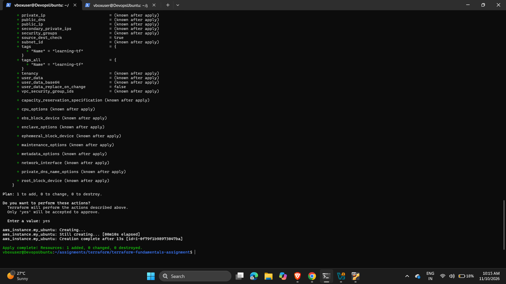
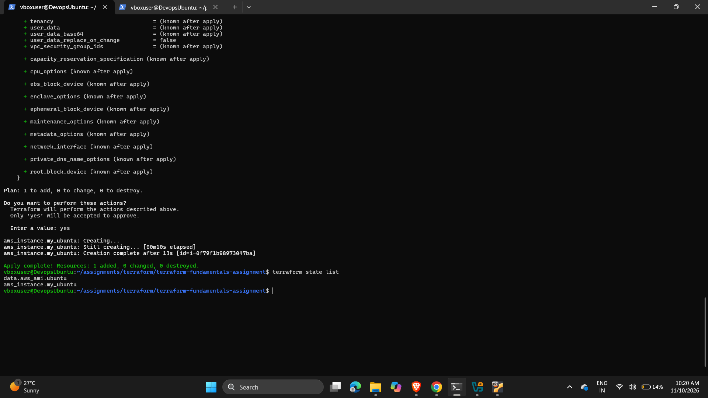
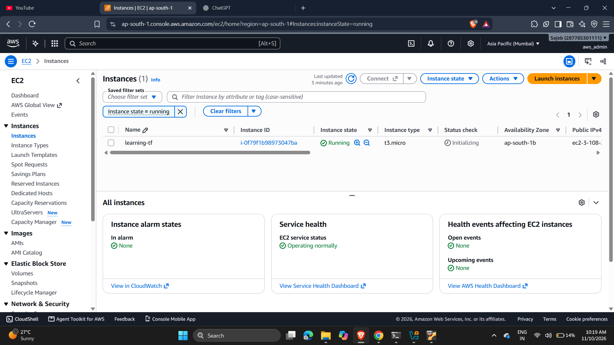
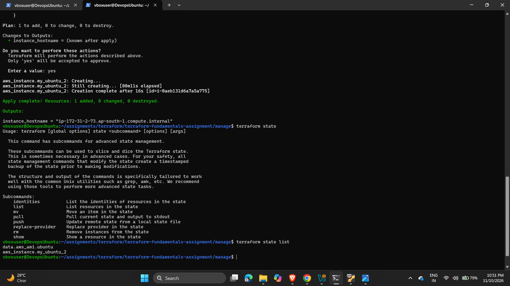
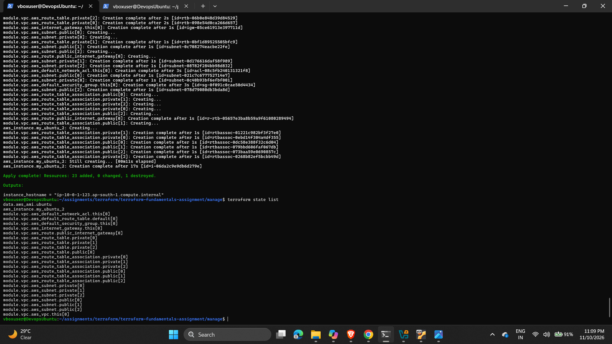
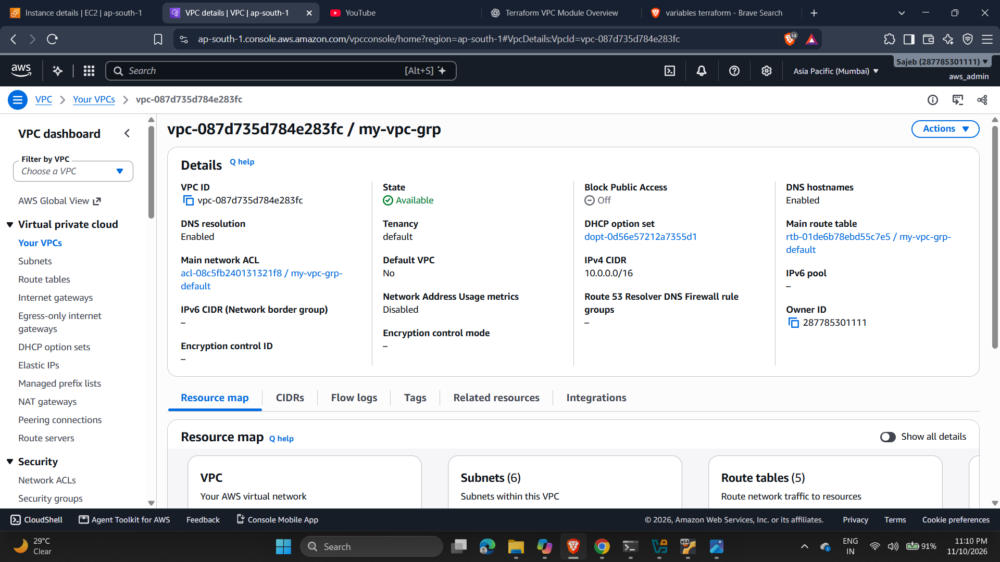
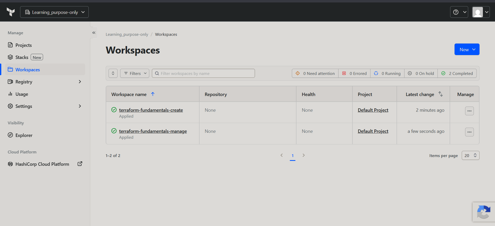
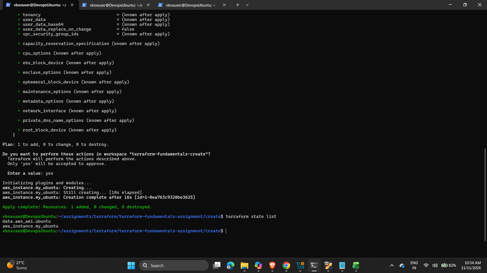
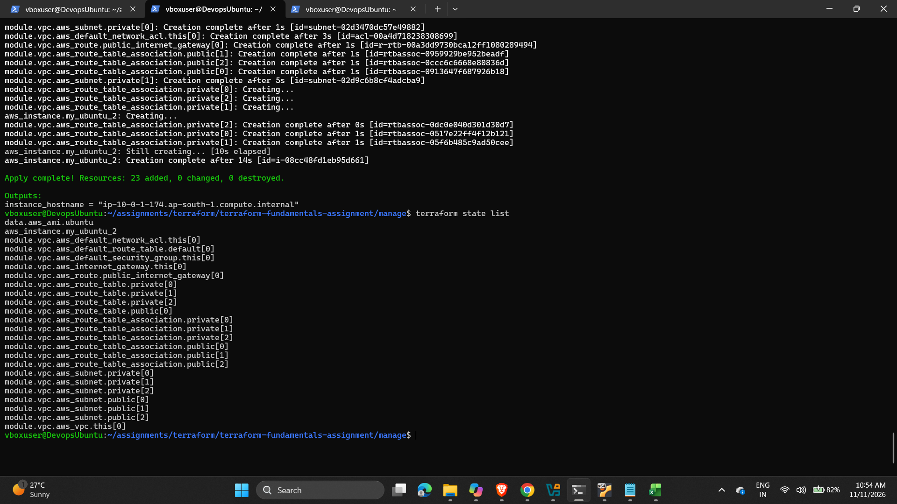

# Terraform Fundamentals Assignment

Hands-on exercises covering the core Terraform workflow on AWS: provisioning a single EC2 instance, building a VPC with a community module and placing an instance inside it, and running the same configurations remotely on HCP Terraform (Terraform Cloud) workspaces.

All resources are deployed to **`ap-south-1` (Mumbai)**.

## Table of contents

- [What this covers](#what-this-covers)
- [Repository structure](#repository-structure)
- [Prerequisites](#prerequisites)
- [Part 1: `create/` - first EC2 instance](#part-1-create--first-ec2-instance)
- [Part 2: `manage/` - VPC module, variables and outputs](#part-2-manage--vpc-module-variables-and-outputs)
- [Part 3: `tf-workspaces/` - remote runs on HCP Terraform](#part-3-tf-workspaces--remote-runs-on-hcp-terraform)
- [Cleaning up](#cleaning-up)
- [Notes and troubleshooting](#notes-and-troubleshooting)

## What this covers

| Concept | Where |
| --- | --- |
| Provider and `required_providers` / `required_version` configuration | every `terraform.tf` |
| Data sources (`aws_ami`) | every `main.tf` |
| Resources (`aws_instance`) | every `main.tf` |
| Registry modules (`terraform-aws-modules/vpc/aws`) | `manage/`, `tf-workspaces/manage/` |
| Input variables and outputs | `manage/`, `tf-workspaces/manage/` |
| State inspection (`terraform state list`) | screenshots in each part |
| Remote execution with the `cloud` block (HCP Terraform) | `tf-workspaces/` |

## Repository structure

```
.
├── create/                      # Part 1: single EC2 instance (local state)
│   ├── main.tf
│   ├── terraform.tf
│   └── screenshots/
├── manage/                      # Part 2: VPC module + EC2 in a private subnet (local state)
│   ├── main.tf
│   ├── variables.tf
│   ├── output.tf
│   ├── terraform.tf
│   └── screenshots/
└── tf-workspaces/               # Part 3: same configs, run on HCP Terraform
    ├── create/                  #   -> workspace: terraform-fundamentals-create
    ├── manage/                  #   -> workspace: terraform-fundamentals-manage
    └── screenshots/
```

## Prerequisites

- [Terraform](https://developer.hashicorp.com/terraform/install) `>= 1.2.0`
- An AWS account and credentials available to Terraform (for example via `aws configure` or the `AWS_ACCESS_KEY_ID` / `AWS_SECRET_ACCESS_KEY` environment variables) with permission to create EC2 and VPC resources
- For Part 3 only: an [HCP Terraform](https://app.terraform.io) account, an organization, and `terraform login`

> **Cost warning:** these configurations create real AWS resources. A `t3.micro` instance is small but not free, and the AMI used is an **Ubuntu Pro** image, which may carry an additional hourly charge. Destroy everything when you finish (see [Cleaning up](#cleaning-up)).

## Part 1: `create/` - first EC2 instance

Provisions one EC2 instance using a data source to look up the AMI.

| Item | Value |
| --- | --- |
| Provider | `hashicorp/aws` `~> 4.16` |
| Data source | `aws_ami.ubuntu` - Ubuntu 24.04 (Noble) Pro, owner `099720109477` (Canonical) |
| Resource | `aws_instance.my_ubuntu` - `t3.micro`, tagged `Name = learning-tf` |
| State | Local |

### Run it

```bash
cd create
terraform init
terraform plan
terraform apply
terraform state list
```

Expected state:

```
data.aws_ami.ubuntu
aws_instance.my_ubuntu
```

### Screenshots

| Apply | State list | Instance in console |
| --- | --- | --- |
|  |  |  |

More: [instance details](create/screenshots/create-detailed-ec2.png), [destroy](create/screenshots/create-destroy.png).

## Part 2: `manage/` - VPC module, variables and outputs

Builds a VPC from the public `terraform-aws-modules/vpc/aws` module and launches an instance into one of its private subnets, using input variables and an output.

| Item | Value |
| --- | --- |
| Provider | `hashicorp/aws` `~> 6.72.0` |
| Module | `terraform-aws-modules/vpc/aws` - VPC `my-vpc-grp`, CIDR `10.0.0.0/16`, DNS hostnames enabled |
| Availability zones | `ap-south-1a`, `ap-south-1b`, `ap-south-1c` |
| Private subnets | `10.0.1.0/24`, `10.0.2.0/24`, `10.0.3.0/24` |
| Public subnets | `10.0.101.0/24`, `10.0.102.0/24`, `10.0.103.0/24` |
| Resource | `aws_instance.my_ubuntu_2` in the first private subnet, using the VPC's default security group |
| State | Local |

No NAT gateway is enabled, so the instance in the private subnet has no outbound internet access.

### Inputs

| Variable | Type | Default | Description |
| --- | --- | --- | --- |
| `instance_name` | `string` | `learning-terraform-2` | Value of the EC2 instance's `Name` tag |
| `instance_type` | `string` | `t3.micro` | The EC2 instance type |

### Outputs

| Output | Description |
| --- | --- |
| `instance_hostname` | Private DNS name of the EC2 instance |

### Run it

```bash
cd manage
terraform init
terraform plan
terraform apply

# override a variable
terraform apply -var="instance_name=my-custom-name"

terraform output instance_hostname
terraform state list
```

### Screenshots

| Apply | State list | VPC |
| --- | --- | --- |
|  |  |  |

More: [VPC (2)](manage/screenshots/manage-vpc-2.png), [instances list](manage/screenshots/manage-ec2_instances-1.png), [instance details](manage/screenshots/manage-detailed-ec2.png).

## Part 3: `tf-workspaces/` - remote runs on HCP Terraform

The same two configurations as Parts 1 and 2, but with a `cloud` block in `terraform.tf` so that plan and apply run remotely and state is stored in HCP Terraform.

| Directory | Organization | Workspace |
| --- | --- | --- |
| `tf-workspaces/create/` | `Learning_purpose-only` | `terraform-fundamentals-create` |
| `tf-workspaces/manage/` | `Learning_purpose-only` | `terraform-fundamentals-manage` |

### Run it

1. Log in to HCP Terraform:

   ```bash
   terraform login
   ```

2. Create an organization (or edit the `organization` value in each `terraform.tf` to match yours).
3. In each workspace, add your AWS credentials as **workspace variables** (environment variables `AWS_ACCESS_KEY_ID` and `AWS_SECRET_ACCESS_KEY`, the secret marked sensitive). Remote runs do not use credentials from your local shell.
4. Run each configuration:

   ```bash
   cd tf-workspaces/create
   terraform init
   terraform apply

   cd ../manage
   terraform init
   terraform apply
   ```

The workspaces are created automatically on first `init` if they do not already exist.

### Screenshots

| Workspaces overview | Create run (1 resource added) | Manage run (23 resources added) |
| --- | --- | --- |
|  |  |  |

More: [create workspace](tf-workspaces/screenshots/tf-create-workspace.png), [manage workspace](tf-workspaces/screenshots/tf-manage-workspace-1.png), [EC2 instances](tf-workspaces/screenshots/ec2-instances.png).

## Cleaning up

Destroy resources in each directory you applied, to avoid ongoing charges:

```bash
cd create && terraform destroy
cd ../manage && terraform destroy
cd ../tf-workspaces/create && terraform destroy
cd ../manage && terraform destroy
```

For the HCP Terraform workspaces, `terraform destroy` queues a remote destroy run; confirm it when prompted. You can then delete the workspaces from the HCP Terraform UI if you no longer need them.

## Notes and troubleshooting

- **Pinned AMI name.** The `aws_ami` data source filters on one exact Ubuntu Pro 24.04 image name dated `20260320`. If AWS or Canonical deprecates that image, `terraform plan` will fail with "no matching AMI". Loosen the filter (for example, use a wildcard such as `ubuntu-pro-server/images/hvm-ssd-gp3/ubuntu-noble-24.04-amd64-pro-server-*`) to track newer builds.
- **Different provider versions.** `create/` pins the AWS provider to `~> 4.16` while `manage/` pins `~> 6.72.0`. Run `terraform init` separately in each directory.
- **Unpinned module version.** The VPC module has no `version` constraint, so `terraform init` fetches the latest release. Pin it if you need reproducible runs.
- **Lock files.** `.gitignore` lists `.terraform.lock.hcl`, but lock files are currently tracked in the repo. Commit them if you want consistent provider selection across machines.
- **State and secrets.** `*.tfstate`, `*.tfvars` and `.terraform/` are git-ignored. Never commit credentials.
